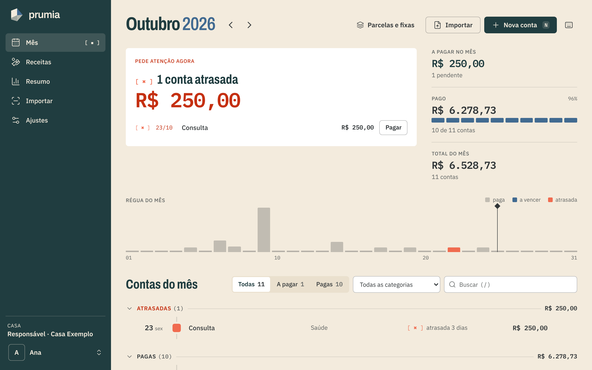
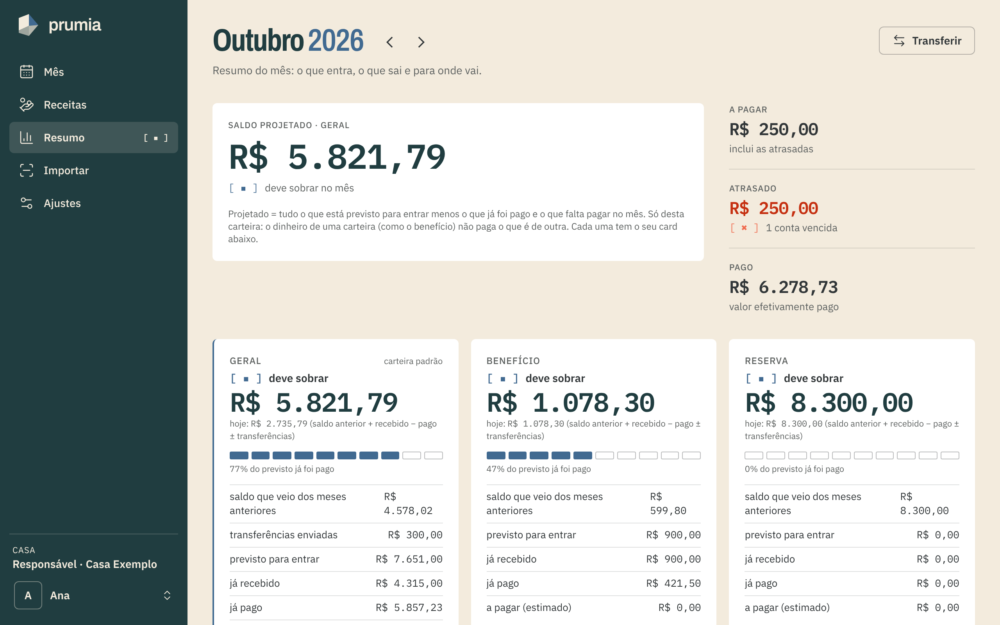
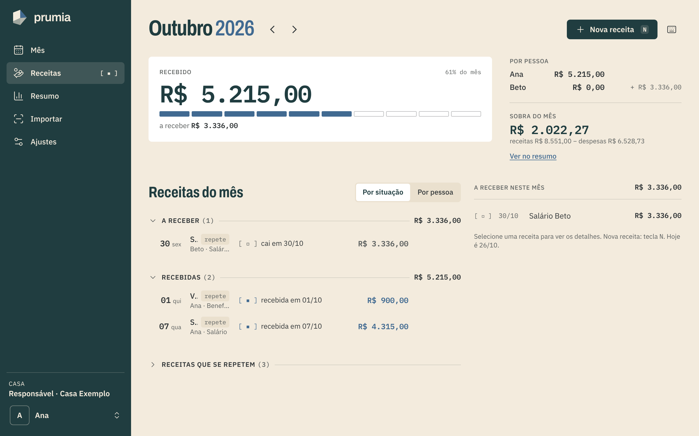

<div align="center">


# prumia

**Clareza para construir o futuro.**

Finanças da casa sem planilha: as contas que vencem, o dinheiro que entra e o que deve sobrar no fim do mês.

[**Ver a demonstração**](https://prumia.pages.dev/demo/) · [Documentação](https://prumia.pages.dev) · [Primeiros passos](https://prumia.pages.dev/guias/primeiros-passos/)


<sub>A household finance app (pt-BR): bills, income forecasting and month-end balance, self-hosted. Go + React + PostgreSQL.</sub>

</div>

---



## O que ele faz

- **Nenhuma conta esquecida.** Cada mês mostra o que vence, o que já foi pago (fica na lista, riscado) e o que atrasou. Pagar é um toque.
- **Saber se vai sobrar.** O saldo projetado soma o que está previsto para entrar e tira o que já foi pago e o que falta pagar, **por carteira**: o que sobra no vale-refeição não paga o aluguel.
- **Menos digitação.** Parcelas e contas fixas se repetem sozinhas; o boleto em PDF, foto ou print vira conta (leitura local, com OCR).
- **Salário no dia certo.** Receitas previstas mês a mês, com INSS, IRRF e outros descontos, no 5º dia útil ou no último dia útil, contando feriados.
- **Dinheiro da casa.** Carteiras, transferências, "conferir saldo" com o banco, meta de reserva de emergência e investimentos comparados ao CDI.
- **Para a casa toda.** Cada pessoa com a sua conta, papéis (Responsável, Participante, Só leitura), convites por link e várias casas por conta.

| Resumo do mês | Receitas |
|---|---|
|  |  |

## Como é feito

```
web/ (React 19 + Vite)  ──►  nginx  ──►  api/ (Go, Gin)  ──►  PostgreSQL
        ▲                                     ▲
        └──── tipos gerados ◄── openapi/openapi.yaml ──► interfaces geradas
```

| Camada | Escolhas |
|---|---|
| **API** | Go, Gin e GORM num monólito modular (`internal/<domínio>/` com handler → service → repository) |
| **Contrato** | **Spec-first**: `openapi.yaml` gera as interfaces Go (oapi-codegen) e os tipos TypeScript; mudou o contrato, o build quebra |
| **Banco** | PostgreSQL com migrations versionadas (goose, Up/Down testados); isolamento por casa reforçado com **chaves estrangeiras compostas** |
| **Front** | React 19, TypeScript, Tailwind 4 com tokens semânticos e 9 temas (contraste conferido por script), PWA instalável |
| **Boleto** | Texto do PDF → código de barras → Tesseract, com o arquivo **só em memória** (nunca em disco nem em log) |
| **Infra** | Docker Compose com 3 containers (api, db, web); só o nginx publica porta; acesso via Tailscale ou Cloudflare Tunnel |
| **Site** | Astro + Starlight gerado a partir dos guias em Markdown, com a demonstração publicada no Cloudflare Pages |

### Decisões que valem a leitura

- **Dinheiro é `int64` em centavos**, nunca `float`; datas de calendário têm tipo próprio, sem fuso.
- **Estado derivado**, não gravado: "paga" é `paid_at != null`, "atrasada" é pendente e vencida. Não existe coluna `status`.
- **Segurança**: argon2id, sessão em cookie `HttpOnly` + `SameSite`, tokens (sessão, convite, nova senha) guardados só como hash
  SHA-256 e enviados no fragmento da URL, limite de tentativas por IP e por e-mail com **bloqueio progressivo**.
- **Testes de verdade**: cerca de 180 testes de integração contra **PostgreSQL real** (testcontainers, um banco por teste, copiado de
  um modelo já migrado), além de testes de unidade e da interface (Vitest + Testing Library).
- **CI** com 5 jobs (API, front, site, hooks de Git e imagens Docker) a cada PR.
- **A demonstração não tem servidor**: é o próprio app com uma API falsa em memória, tipada pelo contrato, que fica fora do build de produção.

## Rodar localmente

Requisitos: Docker (com Compose), Go 1.27 e Node 22.

```bash
cp .env.example .env         # ajuste a senha do banco
make up                      # sobe api, db e web em http://localhost:8080
make help                    # todos os comandos (testes, lint, migrations, backup...)
```

O primeiro cadastro cria a sua casa; as próximas pessoas entram por convite. Guia completo:
[getting-started](docs/developer-guide/getting-started.md) · Documentação técnica: [docs/developer-guide](docs/developer-guide/README.md).

## Estrutura

```
api/        backend Go (cmd/, internal/<domínio>/, migrations/)
web/        frontend React (src/demo: a demonstração no navegador)
openapi/    contrato da API (fonte de verdade)
site/       site público: landing, guias e demonstração
deploy/     Docker Compose, nginx e Dockerfiles
docs/       guias de uso, guias técnicos e manual da marca
scripts/    backup, restore e utilitários
```

## Licença

Código sob a [PolyForm Noncommercial 1.0.0](LICENSE): você pode **ler, estudar, rodar e adaptar para uso pessoal, de estudo e sem fins comerciais**. **Uso comercial** (vender, oferecer como serviço, usar em empresa) precisa de autorização do autor. Não é uma licença de código aberto da OSI: o objetivo é deixar o código visível como portfólio e manter a porta comercial com o autor.

O nome **prumia** e o símbolo são a identidade do projeto: ao adaptar o código, use outro nome e outra marca.

Para reportar uma falha de segurança, veja o [SECURITY.md](SECURITY.md).

Projeto pessoal, feito para uso doméstico, sem suporte comercial.
