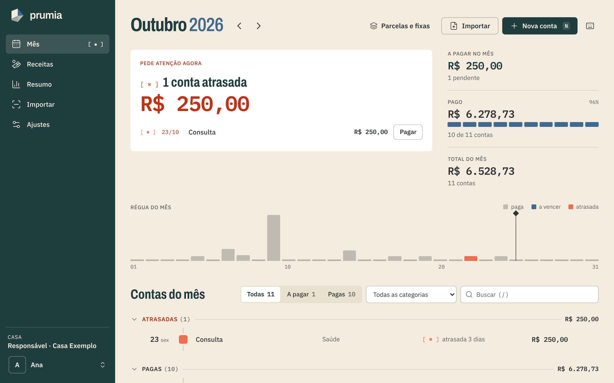
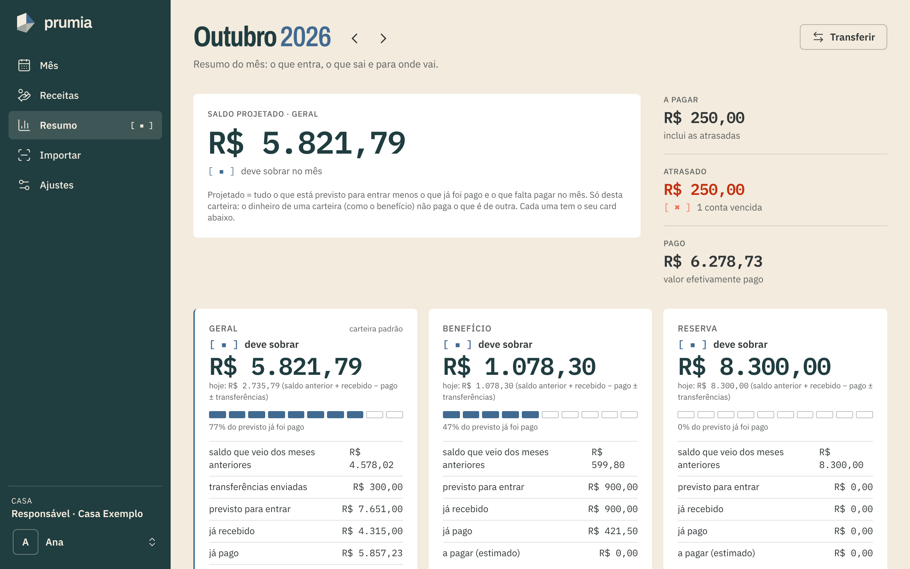
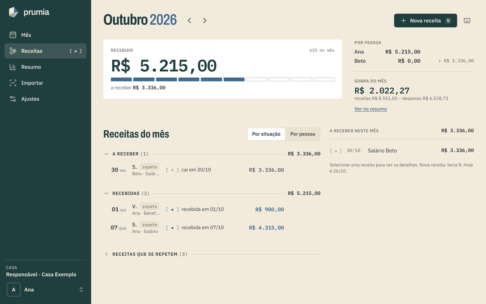
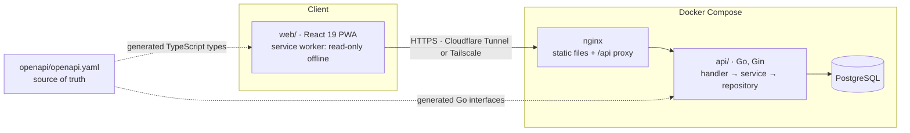

<div align="center">


# prumia

**Clarity to build the future.**

Household finances without spreadsheets: the bills that are due, the money coming in and what should be left at the end of the month.

[**Try the live demo**](https://prumia.pages.dev/demo/) · [Website](https://prumia.pages.dev/en/) · [Developer guide (pt-BR)](docs/developer-guide/README.md)


<sub>[Leia em português](README.pt-BR.md)</sub>

</div>

---



prumia is a self-hosted household finance app, built for Brazil (BRL, Brazilian payroll rules and payment slips) and used
daily by a real household. The interface and the guides are in Brazilian Portuguese; this page describes what it does and
how it is built.

## What it does

- **No bill forgotten.** Each month shows what is due, what is paid (it stays in the list, struck through) and what is overdue. Paying is one tap.
- **Know whether money will be left.** The projected balance adds expected income and subtracts what was paid and what is still due, **per wallet**: what is left on the meal voucher does not pay the rent.
- **Less typing.** Installments and fixed bills repeat on their own; a payment slip (boleto) as a PDF, photo or screenshot becomes a bill, read locally with OCR.
- **Salary on the right day.** Income is forecast month by month with payroll deductions (INSS, income tax), on the 5th or the last business day, accounting for national holidays.
- **Household money.** Wallets, transfers, balance reconciliation with the bank, an emergency fund goal and investments compared to the interbank rate (CDI).
- **For the whole household.** One account per person, roles (owner, participant, read-only), invitation links and several households per account.
- **Works with the server off.** The installed PWA opens offline in read-only mode, showing the last data seen and when it is from.

| Monthly summary | Income |
|---|---|
|  |  |

## How it is built



| Layer | Choices |
|---|---|
| **API** | Go, Gin and GORM as a modular monolith (`internal/<domain>/` with handler → service → repository) |
| **Contract** | **Spec-first**: `openapi.yaml` generates the Go interfaces (oapi-codegen) and the TypeScript types; change the contract and the build breaks |
| **Database** | PostgreSQL with versioned migrations (goose, Up/Down tested); per-household isolation reinforced with **composite foreign keys** |
| **Frontend** | React 19, TypeScript, Tailwind 4 with semantic tokens and 9 themes (contrast checked by a script), installable PWA with read-only offline |
| **Boleto** | PDF text → barcode → Tesseract, with the file **in memory only** (never on disk, never in logs) |
| **Infra** | Docker Compose with 3 containers (api, db, web); only nginx publishes a port; access through Tailscale or a Cloudflare Tunnel |
| **Site** | Astro + Starlight generated from the Markdown guides, with the demo published on Cloudflare Pages |

### Decisions worth reading

- **Money is `int64` cents**, never a float; calendar dates have their own type, with no time zone.
- **Derived state**, not stored: "paid" is `paid_at != null`, "overdue" is pending and past due. There is no `status` column.
- **Security**: argon2id, session in an `HttpOnly` + `SameSite` cookie, tokens (session, invitation, password reset) stored only as
  SHA-256 hashes and sent in the URL fragment, login rate limits per IP and per e-mail with **progressive lockout**.
- **Real tests**: about 180 integration tests against a **real PostgreSQL** (testcontainers, one database per test, cloned from an
  already migrated template), plus unit tests and UI tests (Vitest + Testing Library).
- **End-to-end tests**: Playwright drives a real browser against the full stack (nginx, API, PostgreSQL) started from the production Compose file, including the offline mode.
- **CI** on every pull request: API, frontend, site, Git hooks, Docker images and end-to-end tests.
- **The demo has no server**: it is the app itself with an in-memory fake API, typed by the contract and left out of the production build.
- **Offline without stale surprises**: the service worker serves cached reads only when the server is unreachable, never replaces
  a 4xx, and the UI always says how old the data is.

## Run it locally

Requirements: Docker (with Compose), Go 1.27 and Node 22.

```bash
cp .env.example .env         # set the database password
make up                      # starts api, db and web at http://localhost:8080
make help                    # every command (tests, lint, migrations, backup...)
```

The first sign-up creates your household; other people join by invitation. Full guide (pt-BR):
[getting-started](docs/developer-guide/getting-started.md).

## Repository layout

```
api/        Go backend (cmd/, internal/<domain>/, migrations/)
web/        React frontend (src/demo: the in-browser demo)
openapi/    API contract (source of truth)
site/       public site: landing page, guides and demo
deploy/     Docker Compose, nginx and Dockerfiles
docs/       user guides, developer guides and brand manual
scripts/    backup, restore and utilities
```

## License

Code under the [PolyForm Noncommercial 1.0.0](LICENSE) license: you may **read, study, run and adapt it for personal, educational
and noncommercial use**. **Commercial use** (selling it, offering it as a service, using it in a company) requires the author's
permission. This is not an OSI open source license: the goal is to keep the code visible as a portfolio piece.

The name **prumia** and its symbol are the project's identity: if you adapt the code, use another name and brand.

To report a security issue, see [SECURITY.md](SECURITY.md).

A personal project made for home use, with no commercial support.
